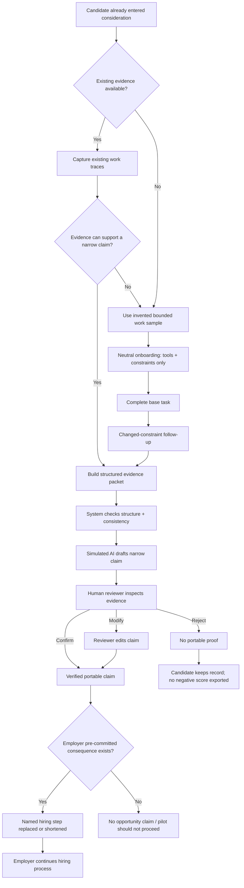
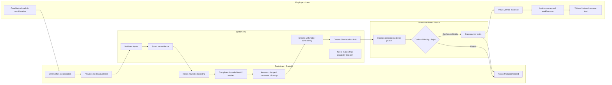

# WEEK 9 · BUSINESS BENDING PACKET
## First-proof Hiring Handoff Lab

**Student:** Hana Dager Abascal  
**Role:** Operator  
**Chapter:** Chapter 8 — *The Job Savior*  
**Primary vacuum:** First-proof  
**Packet status:** PRE-CODE / SOURCE OF TRUTH  
**Required repo path:** `docs/PACKET.md`

> **Build anchor:** “First-proof only deserves to exist when valid evidence changes what an employer actually does next.”

---

# 0. Executive snapshot

## The slice

This ship does **one thing**: it shows how a candidate who is **already in consideration** can turn a narrow piece of evidence into a **human-reviewed First-proof claim** that activates **one hiring consequence agreed in advance by the employer**.

The demo is intentionally narrow. It is not a marketplace, a credential platform, a CV layer, a job board, a predictor of job performance, or a system for certifying all informal work.

## The one mechanism being tested

**Already considered → existing evidence first → bounded task only if needed → changed-constraint transfer check → simulated AI evidence draft → human review → verified narrow claim OR no portable proof → named hiring step replaced/shortened.**

## The one thing that must be true

If valid proof does **not** change what the employer does next, the product has no operational value. A credible-looking artifact that leaves the hiring workflow unchanged is just another credential.

## The shadow clause

First-proof must never become a new paper ceiling. It cannot be used for eligibility, ranking, automatic rejection, or initial review order. It only adds evidence **after** the candidate has entered consideration.

## What this MVP may claim

> “This demo shows how a narrow capability claim can be assembled from defined evidence, checked under a changed constraint, human-reviewed, and connected to one pre-agreed hiring-step consequence.”

## What this MVP may not claim

- It proves Daniela will be a good employee.
- It predicts future job performance.
- It certifies a universal skill level.
- It eliminates hiring bias.
- It solves informal employment.
- It creates jobs.
- It is equivalent to CONOCER certification.
- AI verifies the worker.

---

# 1. Problem in my words

I began Week 9 thinking the problem was that informal work in Mexico “never counted.” I no longer believe that diagnosis is precise enough. Informal work can create real value, judgment, customer knowledge, discipline, and capability. The failure appears when that capability has to cross into a new labor-market context and the next decision-maker cannot cheaply determine what is trustworthy, attributable, relevant, and transferable.

The problem for this ship is therefore **not recognition in the abstract**. Mexico already has partial recognition infrastructure, including CONOCER. The problem I am testing is the **handoff** between evidence and a hiring action.

A candidate may arrive with work traces, references, records, or recognized competency. The system must first ask whether those existing traces are enough to support one narrow claim. If they are, it should not manufacture another experience. If they are not, a bounded training task may be used as a fallback — but only with invented or training material, never unpaid productive work.

The system must keep four states separate:

1. **Artifact exists** — there is something concrete to inspect.
2. **Facts are consistent** — the record is internally coherent.
3. **Transfer is demonstrated** — the person can explain or act under a changed constraint, not merely repeat the taught procedure.
4. **Human verification exists** — a trained reviewer decides whether the evidence supports the narrow claim.

Only after those states are visible may the employer apply a pre-agreed workflow consequence.

## Problem statement

> A candidate can have real capability or credible traces of work, yet the next employer still repeats its own screening because the evidence is not packaged, bounded, reviewed, or tied to a hiring rule the employer has already agreed to honor.

## Why Operator owns this problem

The Operator question is not “Can we build a proof artifact?” It is:

- Who creates the record?
- Who can change it?
- Who verifies it?
- What exactly is verified?
- What is never inferred?
- What does the employer stop doing because this exists?
- What happens when the reviewer rejects the claim?
- What happens when the employer has not pre-committed?
- What breaks first at 100 users?
- What becomes existential at 100,000 users?

**Scale is not issuing more proof. Scale is maintaining the meaning of that proof.**

---

# 2. Product hypothesis and kill logic

## Product hypothesis

For a narrow junior role family where demand still exists, a worker-owned, human-reviewed evidence packet can reduce employer uncertainty **only if** the employer agrees in advance that a valid claim changes one named hiring step.

## Conditions that must be true

The pilot is only worth running if all are true:

1. Junior demand still exists in the target role family.
2. The worker has a plausible capability worth testing or translating.
3. Existing evidence is checked before creating a new task.
4. The capability can be represented as a narrow observable claim.
5. The onboarding can avoid teaching the answer that will later be measured.
6. Transfer can be checked with a changed constraint.
7. A human reviewer can verify the claim reliably and quickly.
8. A named employer agrees before the pilot that valid proof changes one named hiring step.
9. The proof remains additive; it is not an eligibility gate or ranking signal.
10. The task uses invented/training material unless real productive work is paid.

## Product-level kill switches

Kill or pause the idea if any of the following is true:

- **Demand failure:** employers trust the candidates but simply no longer need enough junior workers.
- **Recognition failure:** no employer will pre-commit to replace or shorten a hiring step.
- **Verification failure:** reviewers cannot reach consistent decisions quickly enough.
- **Transfer failure:** people can pass only when the exact answer was taught in onboarding.
- **AI-authorship failure:** AI-written answers pass without understanding and the product cannot distinguish assisted output from transferable judgment.
- **Calibration failure:** the same claim means materially different things across tasks or reviewers.
- **Duplication failure:** CONOCER or another accepted mechanism already solves the exact decision better; First-proof would only add another layer.

---

# 3. Exact user and actors

## Primary interaction user — Laura Méndez

**Fictional profile**

- Age: 38
- Role: Hiring Operations Lead at fictional **Norte Components**, Monterrey
- Hiring need: Junior Customer Operations Coordinator
- Hiring pattern: repeated junior hiring; high screening volume
- Current flow: eligibility review → work-sample test → interview
- Digital comfort: high; ATS-style tools are normal
- Time budget: under 2 minutes to interpret unfamiliar evidence
- What she wants: reduce duplicate screening without lowering trust
- What she distrusts: generic badges, AI-generated scores, opaque “skill levels,” claims with no supporting evidence
- What makes her quit: if the tool adds work instead of removing a step, asks her to trust AI judgment, or cannot explain exactly what was observed
- Success in her words: “I can see what was actually demonstrated, what was not, and which step I am allowed to skip.”

## Protected subject / worker — Daniela Ruiz

**Fictional profile**

- Age: 26
- Current situation: career changer with customer-facing experience
- Target: Junior Customer Operations Coordinator in a plant environment
- Existing traces: fictional follow-up logs, closed-case notes, and reference artifacts
- Gap: no employer-trusted proof that her judgment transfers to the target context
- Constraints: no CV, RFC, bank account, paid tool, or current-employer referral required to start
- Protection: the record belongs to Daniela; absence of proof is never exported as a negative record
- Allowed outcome: verified claim OR no portable proof

## Human reviewer — Marco Silva

**Fictional profile**

- Role: trained First-proof reviewer
- Input: compact evidence packet
- Decision: confirm / modify / reject
- Responsibility: decide whether evidence supports the narrow claim
- Not allowed: predict general employability, assign a universal score, or infer unsupported traits

## System / AI

- Captures structured state
- Validates required fields
- Checks internal consistency
- Organizes evidence
- Drafts a narrow claim
- Flags missing evidence
- Never makes the final portable-capability decision
- Every AI-produced statement in the demo is labeled **Simulated AI draft**

---

# 4. Success definition

> **Before the module closes, Laura can open Daniela only after Daniela has already entered consideration, inspect one human-reviewed escalation-judgment claim, see exactly what evidence supports it and what remains unproven, and activate the employer’s pre-committed “first work-sample test waived” outcome — while the product never ranks Daniela, never uses First-proof as an eligibility gate, never exposes a negative employability score, and never lets AI make the final capability judgment.**

## Success is observable at the live URL when

1. Daniela is visibly marked **Already in consideration** before proof is shown.
2. Existing evidence is shown before any new task is offered.
3. The demo can decide that existing evidence is insufficient.
4. The fallback task uses invented/training material only.
5. Onboarding teaches tools and constraints, not the answer.
6. A changed-constraint follow-up tests transfer.
7. AI creates only a labeled draft.
8. Human review is mechanically required before proof exists.
9. Confirm, Modify, and Reject all work.
10. Reject yields **No portable proof**, never “failed candidate.”
11. A verified claim shows conditions and limitations.
12. The employer commitment visibly changes one named step.
13. There is no ranking, percentage, universal score, or “proof-only” filter.
14. If employer commitment is turned off, the interface states that no opportunity claim can be made.

## Non-success

The product is **not successful** merely because:

- a pretty badge appears,
- AI writes a convincing paragraph,
- Daniela completes the task,
- the employer says the proof is “interesting,”
- or the system stores a certificate.

The test passes only when valid evidence changes a workflow action.

---

# 5. Image-generated mockup

**Required file:** `docs/mockups/first-proof-handoff.png`

The core mockup is the **Hiring Handoff** screen because that is where the Week 9 thesis becomes operational.


## Mockup requirements

### Header

- Daniela Ruiz
- Junior Customer Operations Coordinator
- `Already in consideration`
- `Fictional demo data`

### Narrow claim panel

> “Under a changed customer constraint, Daniela identified the cases requiring escalation, documented why, and did not resolve beyond the authority defined in the task.”

Scope limit:

> “This does not predict performance across all customer-operations roles.”

### Evidence chain panel

1. Existing artifact found
2. Facts internally consistent
3. Changed-constraint follow-up completed
4. Simulated AI draft prepared
5. Human review required

No overall score appears.

### Reviewer panel

- Confirm claim
- Modify claim
- Reject / No portable proof

### Employer commitment panel

- `Pre-agreed hiring consequence`
- `If verified → First work-sample test waived`
- `First-proof was not used for eligibility or initial review order.`

## Visual design rule

The product should feel like an audit trail, not a gamified assessment. No stars, employability percentages, “top talent” labels, celebratory confetti, rankings, or red failure badges.

---

# 6. End-to-end user journey

| Stage | Actor | What happens | What must be visible | Failure path |
|---|---|---|---|---|
| 0 | Employer | Candidate enters normal consideration | `Already in consideration` | Proof remains hidden if not in consideration |
| 1 | Worker/System | Existing traces are loaded | Source + attribution + fictional label | Insufficient traces triggers fallback task |
| 2 | System | Evidence sufficiency check | Why a claim can/cannot be supported | No claim if unsupported |
| 3 | Worker | Neutral onboarding | Tools, time, authority, help rules | Priming check fails → revise onboarding |
| 4 | Worker | Base task | Decisions + rationale | Incomplete submission blocked |
| 5 | Worker | Changed-constraint follow-up | New condition appears only after base response | No transfer claim if follow-up absent |
| 6 | System/AI | Evidence packet prepared | Facts separated from AI draft | Missing evidence flagged |
| 7 | Reviewer | Confirm / Modify / Reject | Evidence + assistance + limitations | Reject = No portable proof |
| 8 | Employer | Verified claim appears | Pre-agreed consequence | No commitment = no opportunity claim |
| 9 | Employer | Named step changes | `Work-sample test waived` | Hiring continues normally if no proof |

---

# 7. Evidence state machine

The product must not collapse all evidence into one “passed/failed” result.

## States

**S0 — Consideration confirmed**  
Daniela is already inside the hiring pool. Proof is not used to get her into the pool.

**S1 — Artifact exists**  
A concrete record or bounded-task output exists.

**S2 — Facts consistent**  
Basic dates, arithmetic, sequence, and internal record logic are coherent.

**S3 — Transfer response captured**  
Daniela responds after one meaningful constraint changes. This checks whether the claim survives beyond memorized procedure.

**S4 — Human review complete**  
Reviewer confirms, modifies, or rejects the draft claim.

**S5 — Portable claim exists**  
Only a confirmed or modified claim becomes portable.

**S6 — Employer consequence activates**  
Only if the employer had committed beforehand.

## Valid terminal outcomes

- `Verified portable claim → named hiring step changed`
- `No portable proof → no negative score exported`
- `No employer commitment → no opportunity claim`

---

# 8. Mermaid flowchart — code



## Flowchart — visual


---

# 9. Mermaid swimlane — code



## Swimlane — visual


## Responsibility rule

The system may organize and check evidence. AI may draft language. **Only the human reviewer can create the portable claim.** The employer does not certify the worker; it applies the workflow consequence it previously agreed to.

---

# 10. Benchmark line — GLOBAL → LOCAL

> **The best existing solution on Earth for this is Parker Dewey Micro-Internships: paid, bounded projects for real companies that let employers observe early-career candidates through actual work.**

> **Mine differs or localizes by using existing evidence first, falling back to invented/training work only when evidence is insufficient, separating AI preparation from human verification, keeping the proof worker-owned, and requiring a named hiring-step commitment before calling the proof useful.**

## What I import

- Bounded work instead of a long internship
- Concrete deliverables
- Employer-readable evidence
- Reduced administrative burden around the experience

## What I do not import blindly

- Company-selected access as the only way into proof
- Any assumption that a new project is always needed
- Unpaid productive work
- Employer ownership of the record
- A claim that project completion itself proves general capability

## Local constraint: CONOCER

CONOCER is not a competitor to ignore; it is a duplication check. If an existing relevant Competency Standard already generates evidence that the target employer accepts for this exact hiring decision, First-proof should ingest or reference that evidence rather than invent a new certificate.

---

# 11. Long view — exactly three sentences

If this slice works, First-proof becomes a worker-owned evidence layer that can translate existing work traces, recognized certifications, or carefully bounded demonstrations into narrow claims employers can actually use. In three years, it could support multiple calibrated task families and employer equivalency agreements without creating a universal skill score, with human verification retained wherever trust requires judgment. Expansion would happen only when the meaning of each claim remains stable across contexts and when proof continues to change a real decision rather than merely adding another credential.

---

# 12. Scope cut

## We are NOT building this week

- CV builder
- Job board
- Candidate marketplace
- Candidate matching
- Full ATS
- Real employer integration
- Real employment decisions
- Real worker records
- Real employer data
- Real productive work
- Real payments
- Universal skill taxonomy
- Universal capability score
- Employability score
- Candidate ranking
- “Top candidate” recommendation
- Automated rejection
- “Proof-only” candidate filter
- Automated final capability verification
- Live CONOCER verification
- CONOCER-equivalent certification
- Reviewer marketplace
- Full dispute system
- Industrial-scale fraud detection
- Multiple role families
- Large-scale calibration
- AI career mapping
- Displacement forecasting
- Second-rung matching
- Revenue model
- ROI claim
- Auth or database unless personal persistence becomes necessary

## We ARE building

One complete fictional handoff:

> **already considered → existing evidence → fallback bounded task if needed → changed constraint → simulated AI draft → human review → narrow portable claim OR no proof → pre-agreed hiring-step consequence**

---

# 13. Blueprint compliance matrix

This is the grading traceability layer. Every Team Blueprint condition must appear as product behavior and as a test.

| Blueprint condition | Product behavior | Where visible | Test |
|---|---|---|---|
| C1 — No new paper ceiling | Proof appears only after consideration; no ranking/filter/rejection | Screen 1 + Screen 8 | T1, T14 |
| C2 — Worker owns proof | Candidate keeps final record; employer sees only proof for current process | Screen 7/8 copy | T19 |
| C3 — Narrow claims, human judged | AI drafts; human confirms/modifies/rejects; no universal score | Screens 6–7 | T7–T11 |
| C4 — No free labor | Invented/training cases only in MVP | Task screens + data labels | T20 |
| C5 — Commitment before pilot | Named step is configured before review; no commitment = no opportunity claim | Screen 8 | T12–T13 |
| C6 — No entry barrier | No CV/RFC/bank account/paid tool/current-employer referral | Entry copy | T21 |
| Existing evidence first | Existing traces shown before fallback task | Screen 2 | T2–T3 |
| AI cannot certify | Final claim cannot exist before reviewer action | Screens 6–7 | T8 |
| No Money claim | No pricing, ROI, or revenue statements in product | Entire app | T22 |
| Demand kill switch | Product copy states proof is wrong tool when demand is binding constraint | About/limitations panel | T23 |

---

# 14. Research dependencies and unresolved gates

The packet must not silently turn unresolved Team Bending questions into facts.

## Gate A — target-role demand

**Unresolved:** how many relevant junior plant customer-service openings exist in Monterrey over a full year.

**MVP treatment:** the employer and role are fictional; the app makes **no market-size or opportunity-volume claim**.

**Kill implication:** if later evidence shows that junior demand is too small or structurally shrinking, First-proof is not the binding intervention.

## Gate B — CONOCER overlap

**Unresolved:** whether a relevant CONOCER Competency Standard already covers the chosen customer-service / escalation capability in a way the target employer accepts.

**MVP treatment:** include a visible note: “Check recognized evidence first.” Do not claim to create a new certification category.

**Decision rule:** if accepted recognized evidence already changes the same hiring step, First-proof should use it rather than duplicate it.

## Gate C — payer

**Unresolved:** who pays for reviewer time and evidence preparation; Team 6 had no Money role.

**MVP treatment:** no revenue claim, no price, no ROI claim.

---

# 15. Architecture + stack

| Component | Purpose | Technology | Data | Real vs simulated | Security / trust rule |
|---|---|---|---|---|---|
| Web app | Run end-to-end demo | Next.js + TypeScript | Fictional task + proof state | Real interface / fictional data | No secrets client-side |
| Styling | Audit-like UI | Tailwind CSS | None | Real | No paid dependency required |
| Demo records | Daniela, Laura, Marco, employer commitment | Typed local TS/JSON | Invented only | Simulated | Clearly labeled fictional |
| State machine | Keep stages separate | TypeScript reducer/state model | proof stages | Real logic | No hidden score |
| Validation | Bound inputs | Zod | text/select values | Real | Length/type/enum checks |
| AI layer | Show AI’s limited role | Deterministic local mock | structured evidence | Simulated | Label every output `Simulated AI draft` |
| Reviewer layer | Confirm/modify/reject | UI state + validated form | claim + reason | Simulated human action | AI cannot bypass reviewer |
| Employer commitment | Map valid proof to step | local config | named step/action | Simulated agreement | Must pre-exist proof |
| Persistence | Keep data minimization | session/local state | fictional state only | Real browser state | No DB needed in v1 |
| Deployment | Public URL | Vercel | static/client app | Real | env vars only if secret added |
| Repo | Evidence of build process | GitHub | code/docs | Real | 5+ meaningful commits, no secrets |

## Architecture decision: no database in v1

The mechanism can be demonstrated without persistent personal data. Avoiding a database means we do not create an unnecessary authentication/RLS surface just to satisfy a demo. If personal persistence is later added, Supabase Auth + Row Level Security become mandatory before that feature is deployed.

---

# 16. Security floor implementation

## 1. No secrets in code or repo

- No API key required for the simulated AI draft.
- If any API is later introduced, secret lives in Vercel environment variables only.
- Before each push: scan `.env*`, source, and git diff.

## 2. Auth if personal data is stored

- v1 stores no real personal data.
- If personal persistence is introduced, stop and add Google auth before deploy.

## 3. Row Level Security if Supabase user tables exist

- Not applicable in v1 because no Supabase table is needed.
- Becomes a hard requirement if persistence is added.

## 4. Every form validates input

- Task answers: enum + required rationale length
- Reviewer note: min/max length
- Modified claim: length + prohibited empty/whitespace state
- No raw user string is sent into a prompt or database in v1

## 5. No real personal data

- Daniela, Laura, Marco, and Norte Components are fictional.
- Every relevant screen says `Fictional demo data`.

---

# 17. Screen-by-screen product specification

## Screen 0 — Start / scope

**Purpose:** orient the grader without turning the product into an explainer page.

Must show:

- Product name
- One-sentence claim
- `Fictional demo data`
- Start demo

Must not show:

- ROI claims
- “AI-powered skill verification”
- universal claims about informal workers

## Screen 1 — Consideration checkpoint

**Purpose:** build the shadow safeguard into the workflow.

Copy:

- `Daniela Ruiz`
- `Target role: Junior Customer Operations Coordinator`
- `Status: Already in consideration`
- “First-proof did not determine application eligibility or initial review order.”

Interaction:

- Continue to evidence

Failure rule:

- If status != already considered, proof route is locked.

## Screen 2 — Existing evidence first

**Purpose:** honor the rule that we do not manufacture new work unnecessarily.

Show 3 fictional traces:

1. Closed customer follow-up log
2. Escalation note from prior context
3. Reference artifact / task record

Each trace shows:

- source type
- what it supports
- attribution confidence for the demo
- `Fictional`

Decision in scripted demo:

- Existing evidence supports customer handling but is insufficient to support transfer into the plant escalation context.

Result:

- `Bounded training task needed`

## Screen 3 — Neutral onboarding

**Purpose:** explain the operating environment without priming the assessed behavior.

Allowed onboarding content:

- interface controls
- task goal
- allowed tools
- time limit
- how to request clarification
- role authority boundary in neutral language

Forbidden onboarding content:

- which exact case requires escalation
- the decision rule that distinguishes the transfer case
- a worked example identical to the assessment
- “Remember: always escalate when X” if X appears in the test

## Screen 4 — Base task

**Purpose:** capture observable behavior.

Use 4 invented customer cases with a simple action set:

- Resolve within authority
- Escalate
- Ask for clarification

For each case require:

- decision
- one-sentence rationale

No correctness indicator appears before submission.

## Screen 5 — Changed-constraint follow-up

**Purpose:** test transfer rather than memorization.

After the base task is submitted, one condition changes, for example:

- the customer request now affects a production commitment,
- authority limit changes,
- or a new dependency appears.

Daniela must:

- keep or revise her decision
- explain why

The interface must not reveal the expected behavior before submission.

## Screen 6 — Evidence packet

**Purpose:** separate observation from interpretation.

Show distinct states:

- Artifact exists
- Facts internally consistent
- Changed-constraint response captured
- Assistance/tool disclosure
- Human review pending

Then show:

`Simulated AI draft`

The draft may say:

> “Under the changed constraint, Daniela identified the cases requiring escalation, documented the reason, and did not resolve beyond the authority defined in the task.”

## Screen 7 — Human review

**Purpose:** demonstrate the trust boundary.

Reviewer sees:

- narrow claim
- evidence excerpts
- task conditions
- changed-constraint response
- assistance/tool disclosure
- scope limitation

Actions:

- Confirm
- Modify
- Reject

Reject state copy:

> `No portable proof generated.`

Never:

> `Daniela failed.`

## Screen 8 — Hiring handoff

**Purpose:** prove operational value.

Show:

- verified narrow claim
- human reviewer
- conditions
- limitations
- employer pre-commitment
- result: `First work-sample test waived`

Also show:

> “This proof did not determine eligibility or initial review order.”

## Screen 9 — Limits / kill condition

Compact drawer or footer panel:

- “This proof does not predict future job performance.”
- “No proof is not a negative worker record.”
- “If the role no longer has meaningful junior demand, proof is not the binding solution.”

---

# 18. Claim grammar and evidence rubric

## Portable claim grammar

Every claim must follow this structure:

> **Under [defined conditions], the participant [observable action] on [bounded task/evidence], with [allowed assistance], producing [observable result].**

Optional final clause:

> **A human reviewer confirmed that the evidence supports this narrow claim.**

## Forbidden claim grammar

Do not use:

- “is good at”
- “is qualified for”
- “will succeed at”
- “high potential”
- “Level 4 employee”
- “87% employable”
- “AI verified”

## Reviewer decision rubric

### Confirm

Use only when:

- required evidence is present,
- attribution is adequate for the demo,
- changed-constraint response exists,
- assistance is disclosed,
- the draft claim stays within the evidence.

### Modify

Use when:

- evidence supports a narrower claim than AI drafted,
- wording overstates independence,
- conditions need to be added,
- or one observation should be removed.

### Reject

Use when:

- evidence is missing,
- transfer was not demonstrated,
- assistance makes authorship/independence unclear,
- claim exceeds what was observed,
- or the task cannot support portability.

Result of Reject:

- no portable claim
- no negative score
- no public failure record

---

# 19. Anti-priming and transfer protocol

This section directly operationalizes prior course feedback.

## Anti-priming rule

Onboarding may teach:

- interface mechanics
- task context
- constraints
- allowed tools
- how to request help

Onboarding may not teach:

- the exact target behavior
- the correct decision on any later case
- a rule whose wording directly answers the assessment

## Transfer rule

A base-task response alone is not enough for a portable claim if the claim is about judgment.

The participant must face a **changed constraint** after the base response. The change must be meaningful enough that copying the original answer is not automatically correct.

## Transfer acceptance

The evidence packet records:

- original decision
- changed condition
- revised/maintained decision
- rationale
- whether assistance was used

The reviewer sees all five before deciding.

---

# 20. Employer commitment object

The employer commitment is a first-class object in the system, not a sentence buried in a policy page.

```ts
EmployerCommitment {
  fictionalEmployer: "Norte Components"
  targetRole: "Junior Customer Operations Coordinator"
  claimType: "Escalation judgment under changed constraint"
  namedHiringStep: "First work-sample test"
  validProofAction: "Waive"
  agreedBeforePilot: true
  simulated: true
}
```

## Rule

If `agreedBeforePilot !== true`, the final screen may show a verified claim but **must not** show an opportunity or hiring-step benefit.

Instead display:

> “Verified evidence exists, but no employer workflow consequence was committed before this pilot.”

---

# 21. Data model

```ts
Candidate {
  id
  fictionalName
  targetRole
  considerationStatus
}

EvidenceItem {
  id
  sourceType
  description
  fictional
  attributable
  supports
}

TaskAttempt {
  baseDecisions
  rationales
  clarificationRequests
  allowedToolUse
  changedConstraintResponse
}

EvidencePacket {
  artifactExists
  factsConsistent
  transferResponseCaptured
  assistanceDisclosure
  simulatedAiDraft
}

HumanReview {
  reviewerName
  decision // confirm | modify | reject
  finalClaim
  reason
}

EmployerCommitment {
  fictionalEmployer
  targetRole
  claimType
  namedHiringStep
  validProofAction
  agreedBeforePilot
}

PortableProof {
  claim
  conditions
  evidenceSummary
  reviewer
  limitations
  employerConsequence
}
```

**No percentage score exists anywhere in the model.**

---

# 22. Failure modes and mitigations

| Failure mode | Why it matters | Product response | Kill vs fix |
|---|---|---|---|
| AI overstates claim | Trust collapses | Human review required; draft labeled simulated | Fix |
| Reviewer disagreement | Proof meaning drifts | Narrow rubric + audit sample later | Kill if persistent |
| Onboarding teaches answer | Measures memory, not transfer | Neutral onboarding test | Fix before deploy |
| Worker uses allowed AI | Could be mistaken for independent performance | Record allowed tools in conditions | Fix wording |
| Employer has no pre-commitment | Proof changes nothing | No opportunity claim | Kill pilot |
| Employer uses proof as gate | New paper ceiling | Proof hidden before consideration; no filter | Reject employer/design |
| Existing evidence was enough | New task wastes time | Evidence-first branch | Fix flow |
| Real work is unpaid | Exploitative / violates Blueprint | invented training data only | Hard stop |
| Candidate is rejected by reviewer | Could become blacklist | No portable proof; no negative score | Expected outcome |
| Target role demand shrinks | Signaling no longer binding | show kill condition; switch vacuum later | Kill product in role family |
| CONOCER already solves same handoff | Duplicate certification | ingest/reference recognized evidence | Kill duplicate feature |
| State cache leaks prior decision | Demo becomes mechanically false | reset logic + regression test | Fix/redeploy |

---

# 23. Test plan

| ID | Test | Action | Pass condition |
|---|---|---|---|
| T1 | Shadow safeguard | Start demo | Proof inaccessible until `Already in consideration` |
| T2 | Existing evidence first | Open evidence screen | Existing traces appear before new task |
| T3 | Insufficient evidence | Choose insufficient path | Bounded task appears |
| T4 | Anti-priming | Read onboarding | No answer/decision rule is revealed |
| T5 | Required input | Leave rationale blank | Submission blocked |
| T6 | Base task | Submit valid responses | State stored; no instant correctness feedback |
| T7 | Transfer | Complete changed-constraint case | New decision/rationale required |
| T8 | AI label | Open evidence packet | Draft says `Simulated AI draft` |
| T9 | Human boundary | Try to proceed before review | Portable proof cannot be created |
| T10 | Confirm | Reviewer confirms | Narrow verified claim appears |
| T11 | Modify | Reviewer narrows wording | Only reviewer-edited claim becomes portable |
| T12 | Reject | Reviewer rejects | `No portable proof`; no failure score |
| T13 | Commitment on | Verify claim | `First work-sample test waived` appears |
| T14 | Commitment off | Disable pre-commitment | No hiring-step benefit appears |
| T15 | No ranking | Inspect all screens | No score/rank/comparison/filter |
| T16 | Invalid long input | Exceed reviewer-note limit | Validation blocks submission |
| T17 | Assistance disclosure | Mark allowed tool use | Conditions show assistance explicitly |
| T18 | Narrow claim | Inspect final proof | No future-performance/general employability claim |
| T19 | Worker ownership | Inspect final-state copy | Record framed as worker-owned, not employer-owned |
| T20 | No free labor | Inspect task/data labels | Task explicitly training/invented |
| T21 | No entry barrier | Inspect entry flow | No CV/RFC/bank account/paid tool required |
| T22 | No Money claim | Inspect app | No pricing/ROI/revenue statement |
| T23 | Demand kill condition | Open limits | Demand-vs-trust kill condition visible |
| T24 | State reset | Reject, restart, confirm alternate path | No stale waiver/claim survives reset |
| T25 | Mobile layout | Test narrow viewport | Core claim + controls remain usable |

---

# 24. Mechanical pass and required bug-fix cycle

The course requires a real bug, fix, and redeploy. Do **not** manufacture a bug for the transcript.

## Areas most likely to break

1. State reset after reviewer rejection
2. Back-navigation after claim modification
3. Employer commitment toggled after review
4. Changed-constraint response persisting incorrectly
5. Validation on reviewer-modified claim
6. Mobile overflow in evidence tables

## Evidence to capture

For the first genuine bug:

1. screenshot of broken behavior
2. short reproduction steps
3. expected vs actual result
4. diagnosis in BUILDCHAT
5. code change / commit
6. repeated test
7. corrected screenshot
8. redeployed URL/version

---

# 25. Persona-test preparation

## Persona

**Laura Méndez, 38, fictional Hiring Operations Lead at a Monterrey manufacturing company.**

She:

- repeatedly hires junior customer-operations roles,
- has less than five minutes for an unfamiliar evidence artifact,
- distrusts generic badges and AI ratings,
- needs to explain the decision to a hiring manager,
- wants to know what she can safely skip,
- silently gives up when an interface makes her infer what “verified” means.

## Fresh-chat instructions later

Show screenshots from the **deployed product**, one screen at a time, in actual order.

Ask the persona to:

1. narrate what she thinks is happening,
2. state what she thinks the system is claiming,
3. identify what she does not trust,
4. state which hiring step she thinks changes,
5. attempt the decision without hints,
6. say where she would quit.

## Anti-priming rules for persona test

Do not tell her:

- that human review is supposed to reassure her,
- that transfer is the concept being tested,
- that the shadow safeguard is important,
- what the correct interpretation of any screen is,
- or which feature we want her to praise.

## Persona success question

At the end, ask:

> “Based only on what you saw, what exactly would you do differently in your hiring process?”

If she cannot answer that correctly, the handoff is not clear enough.

---

# 26. Build telemetry for the demo

No external analytics are required. The app may keep a local, visible **Demo Event Log** for testing only.

Allowed events:

- consideration_confirmed
- evidence_reviewed
- bounded_task_started
- base_task_submitted
- changed_constraint_submitted
- ai_draft_generated_simulated
- reviewer_confirmed
- reviewer_modified
- reviewer_rejected
- employer_commitment_applied
- demo_reset

Purpose:

- verify the intended order mechanically,
- make debugging easier,
- prove that reviewer action precedes portable proof.

The event log must not contain real personal data.

---

# 27. Commit + deploy plan

Minimum: **6 meaningful commits, 2 deploys**.

1. `docs: add Week 9 packet, diagrams, and mockup`
2. `feat: add consideration checkpoint and fictional demo state`
3. `feat: add evidence-first branch and bounded training task`
4. `feat: add changed-constraint transfer check and simulated AI packet`
5. `feat: add human review and employer workflow handoff`
6. `fix: resolve mechanical-test bug and tighten safeguards`

Optional persona-fix commit:

7. `fix: address persona-test confusion in hiring handoff`

## Deploy 1 — functional alpha

Ship when the complete happy path and reject path work.

Then run the mechanical pass and capture the first genuine bug.

## Deploy 2 — corrected build

Ship after the mechanical fix.

## Deploy 3 — persona fix, if needed

Ship if the Persona Test produces a meaningful usability correction.

## Session Close — every coding session

Before stopping:

1. update `DECISIONS.md`
2. note tomorrow’s first move
3. commit
4. push

---

# 28. DECISIONS.md seed

Record these before coding:

- First-proof appears only after consideration.
- Existing evidence is checked before a bounded task.
- Demo uses invented/training material only.
- AI prepares; human reviewer decides.
- Every AI output is labeled simulated.
- No universal score exists.
- Reject = No portable proof, not failed candidate.
- Changed constraint tests transfer.
- Onboarding does not teach the answer.
- One fictional employer commitment exists before review.
- Valid proof replaces one named step: first work-sample test.
- No commitment = no opportunity claim.
- No proof filter or candidate ranking.
- Proof is worker-owned conceptually.
- No persistent personal data in v1.
- No Money / revenue claim.
- Demand, not trust, is the product-level kill condition.
- CONOCER overlap must be checked before claiming a new certification need.

---

# 29. Build non-negotiables

1. Blueprint first.
2. No CV builder.
3. No job board.
4. No candidate marketplace.
5. No eligibility gate.
6. No ranking.
7. No universal skill or employability score.
8. No automatic rejection.
9. No unsupported AI claim.
10. AI output always labeled `Simulated AI draft`.
11. Human reviewer is required for portable proof.
12. Existing evidence first.
13. Bounded task only as fallback.
14. No free productive labor.
15. Neutral onboarding.
16. Transfer, not memorization.
17. Narrow claims only.
18. Employer commitment before opportunity value.
19. No commitment = no opportunity claim.
20. Reject = no portable proof, not a negative record.
21. Worker ownership preserved.
22. Fictional data only.
23. Every form validates input.
24. No secrets in repo.
25. If personal persistence is later added, auth + RLS first.
26. No revenue claim this week.
27. Kill the role-family use case if demand, not trust, is binding.

---

# 30. Definition of Done

The ship is done only when all are true:

- [ ] `docs/PACKET.md` exists in the repo before implementation commits.
- [ ] Image mockup is saved and referenced in the packet.
- [ ] Mermaid code is present in the packet.
- [ ] Flowchart and swimlane are understandable before code exists.
- [ ] Live URL works without login for fictional demo data.
- [ ] Candidate is already in consideration before proof appears.
- [ ] Existing evidence appears before fallback task.
- [ ] Neutral onboarding passes anti-priming review.
- [ ] Changed-constraint follow-up is implemented.
- [ ] AI draft is visibly simulated.
- [ ] Human reviewer must act before proof exists.
- [ ] Confirm / Modify / Reject all work.
- [ ] Reject generates no negative score.
- [ ] Pre-agreed employer consequence is visible.
- [ ] No employer commitment path is handled honestly.
- [ ] No ranking/filter/universal score exists.
- [ ] No real personal data exists.
- [ ] Forms validate input.
- [ ] GitHub contains no secrets.
- [ ] At least 5 meaningful commits exist.
- [ ] At least 2 deploys exist.
- [ ] One genuine bug is documented, fixed, and redeployed.
- [ ] Persona Test uses screenshots from the deployed build in a fresh chat.
- [ ] Worst persona confusion is fixed and redeployed.
- [ ] `DECISIONS.md` is updated at every Session Close.
- [ ] Final BUILDCHAT is the raw development conversation, not reconstructed.

---

# 31. Operator pre-code critique

## What is still vague?

The exact evidence threshold and reviewer calibration are intentionally simplified. In a real pilot, a named employer and reviewer would need to calibrate the task family before any claim could become portable.

## What breaks first?

**Reviewer consistency.** If two reviewers interpret the same evidence differently, the software may still function while the trust layer silently dies.

## Most dangerous assumption

That an employer will honor the pre-agreed waiver when a valid proof appears. This MVP therefore treats the commitment as a visible system object, not an informal promise.

## Why this is small enough

One fictional candidate. One capability. One fallback task. One changed constraint. One reviewer. One employer. One named hiring consequence. No database. No real personal data.

## What would make this a bad build?

A static page that explains First-proof but never makes the user move through the actual state transition from evidence to review to employer consequence.

---

# 32. Final pre-code gate

Do not start implementation until every answer is YES.

- [ ] Can I explain the feature in one sentence?
- [ ] Is the exact user clear?
- [ ] Is the candidate already in consideration before proof appears?
- [ ] Is existing evidence checked before a new task?
- [ ] Is no portable proof a valid terminal state?
- [ ] Is AI prevented from making the final judgment?
- [ ] Is transfer tested under a changed constraint?
- [ ] Does onboarding avoid teaching the answer?
- [ ] Does valid proof change one named hiring step?
- [ ] Does no commitment block the opportunity claim?
- [ ] Can the user see what the proof does not claim?
- [ ] Are all people and records fictional?
- [ ] Is there no CV builder, job board, ranking, or universal score?
- [ ] Is the security floor satisfied by design?
- [ ] Is the MVP small enough to build, test, fix, redeploy, and persona-test this week?

> **If any answer is NO, fix the packet before code.**

---

# 33. Reference and provenance note

This packet operationalizes the Week 9 Team 6 Blueprint and Hana’s Operator Brain Bending brief. The benchmark logic carried into the packet is limited to the same researched sources already used in the brief: OECD (skills-first assessment/portability), Parker Dewey (bounded paid work), Opportunity@Work (STARs / existing capability), and CONOCER (Mexico’s existing competency-recognition infrastructure).

The MVP does **not** treat unresolved Team Bending research questions as established facts. Target-role demand, payer economics, and exact CONOCER overlap remain research gates and are explicitly excluded from the demo’s claims.
